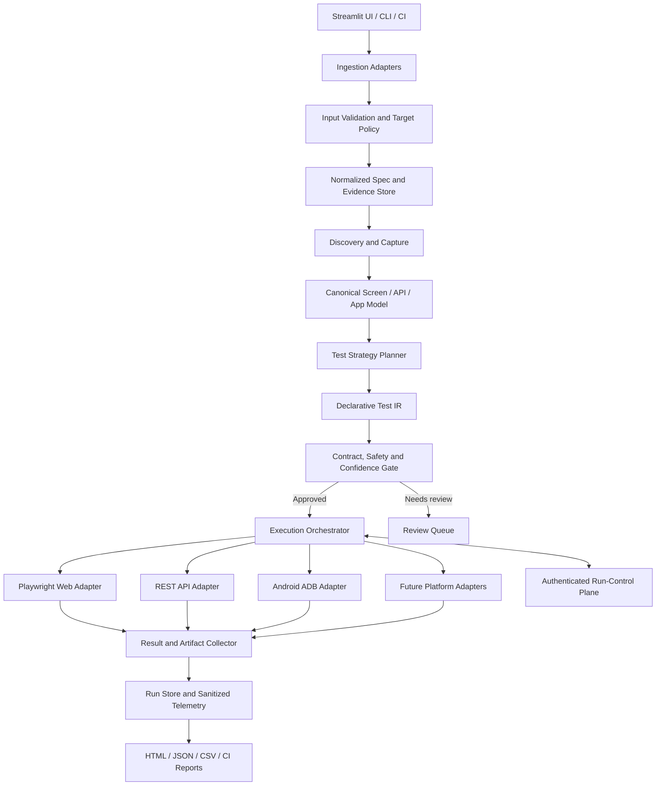

# AI Autonomous QA & Testing Studio
## Loophole Review, Missing Requirements, and Improved Architecture

**Review basis:** The supplied *AI Autonomous QA & Testing Studio — Technical Architecture & System Review Specification* (dated October 2026).  
**Review type:** Specification and risk review, not a source-code audit.  
**Repository stated in source:** `C:\Projects\New folder (6)`  
**Purpose:** Identify holes, tighten the architecture, define safe algorithms, improve test/result contracts, and establish evidence-based release gates.

> **Important limitation:** The supplied material describes intended behavior and lists project files, but does not include the repository implementation. This review can confirm gaps and contradictions in the specification; actual vulnerabilities, code correctness, and the reported test results require repository-level verification.

---

## 1. Executive verdict

The proposed platform has a useful direction: a deterministic engine for discovery and fallback generation, strategy adapters for different test modalities, a browser execution engine, and structured reporting. However, the current specification overstates reliability and production readiness while leaving several high-risk behaviors undefined.

**Top priorities before broad use:**

1. Remove global DOM-overlay suppression and unconditional dialog acceptance from the generated execution shield.
2. Treat generated scripts, target URLs, uploaded spreadsheets/specifications, credentials, authentication state, and control commands as untrusted inputs.
3. Add a safe-crawling policy that prevents accidental writes or destructive actions and stops crawl loops using state fingerprints.
4. Separate test generation from execution; validate each generated case against a typed contract and explicit expected assertions before execution.
5. Make self-healing bounded, evidence-based, observable, and unable to rewrite the expected result.
6. Replace the one-size-fits-all schema with a modality-neutral test-case contract plus executor-specific adapters and a separate execution-result record.
7. Replace “100% offline reliability,” “zero-failure,” and “production-grade / fully verified” claims with measurable, scoped claims and repeatable evidence.

### Readiness assessment

| Area | Assessment from the specification | Required next step |
|---|---|---|
| Deterministic generation | Promising, but semantic limits and confidence are undefined | Define generation contract, confidence, traceability, and negative-case rules |
| Flow discovery | BFS and caps are described; state deduplication and safe actions are not | Define canonical state identity, action policy, URL policy, and crawl budget |
| Execution safety | Current example can hide genuine UI behavior | Remove broad DOM mutation and make dialog handling case-specific |
| Self-healing | Four tiers are claimed but not documented | Specify tiers, thresholds, retry budget, audit trail, and fail-closed behavior |
| API testing | Basic contract/boundary testing is mentioned | Add versioned OpenAPI support, authz, data setup/cleanup, and response assertions |
| Mobile testing | Android ADB hierarchy is described | Explicitly scope supported app types, OS/device matrix, lifecycle, permissions, and gestures |
| Security | XSS/SQL-injection examples exist | Add target authorization, URL/network controls, sandboxing, secret protection, authz tests, and safe payload policy |
| Accessibility | “20-point WCAG” is claimed without a mapped checklist | Identify WCAG version/success criteria and combine automated results with manual review |
| Reporting | Status, duration, screenshot, and notes exist | Add run IDs, attempt history, traces, logs, classifications, provenance, and artifacts |
| Verification | 137/137 is reported, without test inventory or external evidence | Re-run and publish a reproducible, categorized verification report |

---

## 2. Critical loopholes and corrective actions

Severity definitions: **P0** = fix before executing untrusted tests or running against shared/production-like systems; **P1** = fix before relying on the system for release decisions; **P2** = important for maintainability, observability, and scale.

| ID | Severity | Evidence in the supplied specification | Loophole / impact | Recommended correction | Acceptance criterion |
|---|---|---|---|---|---|
| L-01 | P0 | Section 4.4 injects JavaScript that hides fixed backdrops and sets `pointerEvents = 'none'` | A genuine blocker, modal, or overlay defect can be hidden. The test no longer observes normal user behavior and may report a false pass. | Remove the global overlay rewrite. Treat an intercepted click as evidence. Capture a screenshot, inspect the overlay, and either fail or use an explicit test-specific dismissal action. | A deliberately blocking overlay causes the test to fail unless the test explicitly expects and dismisses that overlay. No global style mutation is performed. |
| L-02 | P0 | Section 4.4 registers `page.on('dialog', lambda d: d.accept())` | A confirm/prompt can be accepted without checking its type, message, or intended outcome. That may confirm a destructive action. | Default to Playwright’s normal dialog behavior unless a test declares a dialog expectation. When a dialog is expected, assert type/message and accept or dismiss deliberately. | A simulated delete confirmation is dismissed by default; only the designated delete-confirmation test accepts it after matching the expected message. |
| L-03 | P0 | User-controlled target URLs, live browser inspection, API URLs, and generated code are accepted | URL ingestion and browser navigation can reach unintended internal services, and generated code may perform arbitrary file/process/network actions if run with the host’s privileges. | Use an explicit target allowlist, validate each redirect and resolved address, block loopback/private/link-local/metadata destinations by default, and run generated code in a least-privilege isolated worker with resource/time limits and restricted network/file access. | A URL targeting a disallowed local/private destination is blocked; generated code cannot read unrelated files or launch arbitrary processes; execution stops at the configured resource limit. |
| L-04 | P0 | Section 5 describes a TCP control server on port `8510`, but no authorization protocol | An exposed or impersonated control endpoint could pause, resume, step, or abort unrelated runs. | Bind to loopback by default. Authenticate every command, validate a strict command enum and run ID, reject replays/out-of-order commands, and require authenticated transport if remote control is enabled. | Unauthenticated, malformed, wrong-run, and replayed commands are rejected and audited. The server is not reachable remotely by default. |
| L-05 | P0 | `settings.json` contains credentials/settings; session capture saves `auth.json` | Secrets or authenticated browser state may be copied, committed, logged, or reused after compromise. | Use approved OS/secret-vault storage for credentials; keep auth state out of source control; restrict file permissions; encrypt sensitive artifacts at rest where appropriate; mask logs; implement expiry/revocation and cleanup. | Secret scanning detects no committed credentials/auth state; logs contain no credentials/tokens; session artifacts have restrictive access and expiry/cleanup. |
| L-06 | P0 | Flow Explorer clicks navigation, tabs, accordions and unspecified interactive elements | An exploratory crawl can create records, submit forms, delete data, send messages, or trigger financial/business operations. | Classify actions as `READ_ONLY`, `SAFE_INTERACTION`, `STATE_CHANGE`, or `DESTRUCTIVE`. Allow state-changing/destructive actions only with explicit policy, approved non-production environment, synthetic data, and cleanup. Default discovery to read-only/safe interaction. | A test page containing Save/Delete/Send actions is crawled without invoking them unless an authorized scenario explicitly permits the action. |
| L-07 | P1 | Deterministic synthesis infers forms and actions from topology; examples assert generic success alerts | UI structure cannot establish business rules or prove that data persisted correctly. A generic success toast can pass while the wrong record is created or the backend state is wrong. | Generate assertions from requirements, user stories, API schemas, or explicitly labeled UI-only heuristics. Verify postconditions through the UI and, when authorized, API/database test fixtures. Mark inferred tests as exploratory and lower confidence. | Every release-blocking test has an explicit, traceable assertion. A toast alone cannot validate a business transaction. |
| L-08 | P1 | Section 4.3 says parsing pipeline “guarantees” valid dictionaries and has “zero-failure fallback” | Syntactically repaired JSON can be semantically wrong, incomplete, or assigned to the wrong fields. Naïve brace balancing can fail around quoted braces/escapes. Non-empty output is not necessarily valid or meaningful output. | Use strict parsing first; allow only defined repairs; schema-validate the result; validate required fields, enums, types, references, and invariants; preserve raw input and repair audit; use deterministic fallback only with explicit fallback metadata and coverage warnings. | Malformed or semantically invalid output cannot silently become a normal passing test case. Every repair is recorded; irreparable input returns a typed generation error or labeled fallback. |
| L-09 | P1 | Section 5 claims “4-tier self-healing,” but tiers, ranking, and limits are not defined | A repair may choose the wrong element, broaden a locator, skip a failed action, or change the meaning of the test. A pass after silent repair may conceal a regression. | Define bounded tiers and objective thresholds. Do not repair expected assertions, authorization, or business logic. Record old/new locator, evidence, confidence, and retry outcome. Require review for repeated repairs. | Self-healing never changes expected results or skips an assertion. Every repair is auditable and repeated repairs lower the suite health score. |
| L-10 | P1 | Canonical schema mandates `Playwright_Code` for all cases; `Target` is a URL/route/package string | The contract does not fit API/mobile execution cleanly. It lacks HTTP method, request/response assertions, test data, preconditions, IDs, priority, and requirement links. | Store a modality-neutral executable step/assertion representation; make generated code an optional derived artifact. Add API/mobile-specific typed payloads and a separate run-result schema. | The same test case contract can represent web, API, and Android tests without placing non-Playwright commands in `Playwright_Code`. |
| L-11 | P1 | BFS caps depth and screens, but no canonicalization/state fingerprint is specified | Query parameters, dynamic IDs, pagination, tabs, modal states, duplicate links, and SPA routes can lead to repeated states or uncontrolled breadth. | Normalize URLs and volatile query values; fingerprint meaningful UI/accessibility state plus auth role and active dialog/tab/route; deduplicate visited states and transitions; maintain a per-domain/action budget and report skipped branches. | A synthetic app with cyclic navigation and volatile query strings terminates within budget and reports the reason for each skipped branch. |
| L-12 | P1 | “20-Point WCAG & A11y Tree Audits” is asserted without a named version or criteria map | “20-point” does not establish WCAG conformance, and automated tools cannot by themselves verify all conformance requirements. | Map each automated check to a named WCAG version and success criterion; distinguish machine-detectable violations, manual-review items, and not-tested criteria. | Reports show criterion IDs, evidence, severity, test method, and manual-review status; no blanket compliance claim is produced from an automated scan alone. |
| L-13 | P1 | “Production-Grade / Fully Verified” and 137/137 tests passed | The document gives no test inventory, environment, coverage, assertion quality, historical stability, or mutation/fault-injection results. A fast passing suite may be focused only on helpers. | Label the count as a reported run until independently reproduced. Publish test names/categories, environment and commit, timings, skips, flaky attempts, coverage, and fault-injection results. | CI reproduces the result on a known commit, and injected known faults are detected by the intended tests. |
| L-14 | P1 | Browser execution says Chromium / Microsoft Edge; mobile mentions Android ADB only | Cross-browser and mobile coverage claims can exceed actual execution capability. iOS, WebKit, Firefox, app lifecycle, permissions, and hybrid webviews are not specified. | Publish a supported-platform matrix. Treat unsupported platforms as unsupported, not implicitly covered. Add platform adapters only after defining their capabilities and test data requirements. | Every report lists the exact browser/OS/device/app mode and supported-but-not-run dimensions. |
| L-15 | P1 | Stateful journeys are chained across screens, but test isolation and cleanup are absent | Test ordering and shared data can cause cascading failures, duplicate records, or unreliable reruns. | Give each run isolated browser context and unique synthetic data; establish preconditions; add setup/teardown and idempotent cleanup; record the random seed/data references. | A test passes or fails independently when run alone, in suite order, or after a prior failure. Cleanup is verified. |
| L-16 | P1 | “Security & Input Resilience” uses XSS and SQL-like strings as examples | A visible alert or absence of HTTP 500 is not sufficient evidence of security. Tests may be unsafe on production or may miss stored/reflected/context-specific issues and authorization defects. | Add an authorized security-test mode with allowlisted non-production targets, inert unique canaries, safe request limits, clear evidence, and tests for access control/IDOR, auth expiry, CSRF where applicable, headers, redirects, and validation. Avoid destructive payloads by default. | Security tests can run only against approved targets; each result states what was actually tested and what remains untested. |
| L-17 | P1 | API coverage says schema, boundary and auth tests but not operation semantics | Missing method/status/body/header assertions, pagination, idempotency, rate limits, negative authorization, and stateful operation chains can leave major API defects undetected. | Parse supported OpenAPI versions explicitly; create operation contracts with method, path params, query/header inputs, auth scheme, body schema, expected status/body/header constraints, setup/cleanup, and authorization matrix. | A fixture API with wrong status, invalid response schema, missing permission check, broken pagination, or duplicate non-idempotent behavior is detected. |
| L-18 | P2 | Results store screenshots and text notes; no unified telemetry contract | It is hard to distinguish app defects from environment/runner errors or reproduce a failure without traces, logs, request context, and attempt history. | Add run/test/attempt IDs, structured logs, console/page errors, network failures, traces, screenshot/video links, environment fingerprints, and sanitization. | One test report provides enough sanitized artifacts to reproduce and classify a failure without printing secrets. |
| L-19 | P2 | Status enum is PENDING/RUNNING/PASSED/FAILED/SKIPPED | Environment errors, timeouts, aborts, blocked tests, flaky retries and healed passes are collapsed or unclear. | Add `ERROR`, `BLOCKED`, `TIMED_OUT`, `ABORTED`, `FLAKY`, and an explicit healed indicator; preserve every attempt and define the final status policy. | A runner timeout cannot be reported as an application assertion failure; a retry pass does not erase the original failed attempt. |
| L-20 | P2 | `Duration` is a string and `Screenshot` can be an absolute local path | String durations complicate metrics; absolute paths are machine-specific and may expose local directory names. | Store integer `duration_ms`; store artifact IDs/relative paths or URLs from an artifact store, with access controls and retention rules. | Results are portable between machines and duration analytics require no string parsing. |
| L-21 | P2 | “Sub-millisecond” control and “100% offline reliability” are stated without measurements | These are measurable claims without a measurement method; live URL/API execution inherently depends on the target and its network. | Scope offline claims to deterministic generation/repair if measured; define benchmarks, sample sizes, hardware, cold/warm runs, percentile metrics, and external-dependency assumptions. | Every published performance/reliability claim links to a reproducible benchmark output and its scope. |
| L-22 | P2 | Ingestion section describes OpenAPI 3.0; executive summary also names Postman, while the table omits a Postman row | The ingestion contract is inconsistent and may imply unsupported formats. OpenAPI has multiple published specification versions; support must be stated explicitly. | Add separate OpenAPI and Postman adapters and publish a compatibility matrix, including supported format versions and unsupported features. | The UI rejects unsupported versions clearly and logs the adapter/version used for each generation. |
| L-23 | P2 | Section 2, “End-to-End System Architecture,” has no content/diagram | Readers cannot establish trust boundaries, data flow, persistence, dependencies, or failure boundaries from the current document. | Add a system diagram, data flow, trust boundaries, process boundaries, and run state machine. | An engineer can trace a test from ingestion to report and identify every process that handles credentials or executable code. |
| L-24 | P2 | “Automatically bypasses Microsoft Dev Tunnels warning pages” | A generic bypass policy could skip an important trust/interstitial warning and conceal a misconfigured or unintended target. | Replace generic bypassing with an explicit, owner-approved test-environment policy. Never bypass certificate, identity, browser security, or unknown interstitial warnings automatically. | Only a known, expected warning on an explicitly allowlisted owned environment can be handled, and the event is logged. |

---

## 3. Target architecture

### 3.1 Recommended end-to-end pipeline

### 3.2 Architecture boundaries

- **UI/control plane:** starts runs, shows status, approves state-changing scenarios, and sends pause/resume/abort commands. It must not directly execute arbitrary generated code inside the UI process.
- **Ingestion layer:** parses URLs, stories, OpenAPI/Postman files, Android hierarchy captures, and spreadsheets. Every input is size-limited, format-validated, and tagged with provenance.
- **Policy gate:** validates target hosts, environment, permitted actions, credential scope, network destinations, and run limits before a browser or runner starts.
- **Canonical model:** stores discovered elements, screens, routes, API operations, evidence, and relationships with stable identifiers and a snapshot/version.
- **Planner/generator:** generates declarative steps and assertions, not unrestricted code as the primary representation.
- **Execution workers:** run in isolated processes/containers with least privilege. Use modality-specific adapters. Generated code is treated as untrusted even if produced by the platform itself.
- **Run store:** persists case definitions, attempt history, output, artifacts, generator/runner versions, environment fingerprints, and traceability links.
- **Report layer:** distinguishes product failures, generation failures, environment failures, security blocks, flaky tests, and coverage gaps.

### 3.3 Trust boundaries that must be explicit

1. User-provided URLs versus network destinations reached after redirects.
2. Uploaded files versus parser/runner processes.
3. LLM output versus schema-validated test definitions.
4. Generated code versus host filesystem, OS processes, and network.
5. Browser session state versus secret storage and reports.
6. UI commands versus worker process/control socket.
7. Test application data versus user/business/production data.

---

## 4. Improved algorithm definitions

### 4.1 Safe, bounded flow exploration

The current BFS approach needs a concrete state model and action policy.

**State record** should include, where available:
- normalized URL/route with tracking and volatile query parameters removed;
- page title and stable heading/landmark summary;
- relevant accessibility-tree signature;
- active tab, modal/drawer, expanded accordion, selected filter, and pagination state;
- authenticated principal/role and session identity (never raw credentials/tokens);
- capture timestamp, viewport/device, and snapshot hash.

**Visited-state key:** a normalized route plus a stable state signature. Avoid hashing raw full HTML alone because volatile IDs, timestamps, and random content can make the same state appear new. Keep a separate edge record for the action that led to a state.

**Action policy:**
- `READ_ONLY`: navigate, inspect, read table, capture accessibility tree.
- `SAFE_INTERACTION`: open/close a tab, accordion, or non-mutating drawer.
- `STATE_CHANGE`: submit a form, create/edit a record, change a setting, send a message.
- `DESTRUCTIVE`: delete, refund, purchase, dispatch, submit a legal/financial action, or invoke an irreversible operation.

Default crawling may execute only the first two classes. State-changing/destructive actions require explicit scenario approval, a known test environment, synthetic records, a cleanup plan, and a hard stop when the environment cannot be established.

**Loop prevention and budget:**
1. Validate the start URL and allowlisted host.
2. Normalize the URL and verify each redirect/destination against policy.
3. Fingerprint the current state and stop revisiting an identical state unless a defined state dimension changed.
4. Queue only eligible, same-origin or explicitly allowlisted transitions.
5. Enforce maximum depth, unique states, total actions, time, navigation count, and per-state interaction count.
6. Report every unvisited/blocked branch with a reason: cap reached, external host, unsafe action, duplicate state, auth wall, timeout, or unsupported control.
7. Record exploration coverage as discovered routes/states/transitions—not as a claim that all business paths were covered.

### 4.2 Deterministic synthesis with evidence and confidence

Each generated case should identify:

- **Evidence source:** explicit acceptance criterion, API schema, user story, DOM/accessibility evidence, or heuristic.
- **Purpose:** functional, boundary, negative, security, accessibility, navigation, or exploratory.
- **Preconditions and data requirements.**
- **Executable steps** and **explicit assertions**.
- **Risk/priority**, confidence, and reason for confidence.
- **Requirement/operation/screen reference** and generator version.

Do not infer a business rule solely from the presence of a button. For example, finding a Delete button can justify an exploratory visibility check; it does not establish who is permitted to delete, what confirmation is required, what related data should be removed, or how the backend should behave.

**Suggested confidence gates:**
- High: explicit acceptance criterion or valid contract provides action and verifiable expected result.
- Medium: stable accessibility/UI semantics and clear expected interaction, but business postconditions are not independently available.
- Low: weakly inferred from text/CSS/element order or an ambiguous control.

The exact numeric thresholds should be calibrated from the project’s real results. High-impact tests should not auto-execute on low-confidence inference. Low-confidence cases can be saved as reviewable exploratory suggestions.

### 4.3 Bounded self-healing policy

Self-healing must repair location, not test meaning.

| Tier | Allowed action | Conditions | Result handling |
|---|---|---|---|
| 0 | Reuse the original locator | Original locator is unique and actionable | Execute normally |
| 1 | Resolve an equivalent semantic locator (role + accessible name, label, placeholder, test ID) | Candidate is unique and matches the recorded element intent | Record the substitution and continue |
| 2 | Compare current accessibility/DOM snapshot with the baseline | Semantic fingerprint is close enough and there is exactly one candidate | Re-run the action and all assertions; preserve evidence |
| 3 | Re-discover the route and recreate preconditions | Transition path is known and every step remains safe | Mark the run as healed/review-needed according to policy |
| Stop | No reliable unique candidate, unsafe action, or changed assertion/precondition | Any ambiguity or meaning change | Fail or block; do not guess |

**Non-negotiable rules:**
- Never change `Expected_Result` to make a test pass.
- Never silently skip a failed step or assertion.
- Never switch to a broad locator such as “first button” solely because a stable locator failed.
- Never auto-heal authorization, payment, delete, dispatch, or other critical actions without explicit approved mapping.
- Limit the number of healing attempts per step and per case.
- Save original locator, candidate list, matching evidence, confidence, repair tier, and outcome.
- If the healed path passes, retain the initial failure in attempt history and mark the final result as healed or requiring review—not as an indistinguishable clean pass.
- Measure healing precision against manually adjudicated samples. A high healing rate alone is not success; incorrect repairs are more dangerous than visible failures.

### 4.4 Safe JSON normalization and repair

Replace “guarantees valid structured dictionaries” with a bounded parser contract:

1. Preserve the raw response, source, timestamp, and content hash.
2. Parse strict JSON first.
3. Extract a JSON code block only when there is a clear wrapper/format boundary.
4. Unwrap only explicitly supported provider envelope shapes.
5. Apply narrowly defined repairs (for example, an unambiguous trailing comma or completion of a clearly truncated final array) and record each repair.
6. Parse again using a standards-compliant parser.
7. Validate against the versioned schema and semantic constraints: required fields, enum values, modality, step type, assertions, references, and forbidden combinations.
8. Reject invalid or ambiguous records rather than fabricating missing semantics.
9. If deterministic fallback runs, tag cases `fallback=true`, include a warning and confidence, and disclose what categories were not generated.
10. Never convert malformed input into a successful execution result merely because a non-empty test list was emitted.

### 4.5 Assertion quality

Every executable case should have explicit assertion types, for example:
- `visible`, `hidden`, `enabled`, `disabled`, `text_equals`, `url_matches`;
- `count_equals`, `value_equals`, `attribute_equals`;
- `response_status_equals`, `response_schema_valid`, `header_equals`;
- `record_created`, `record_updated`, `record_absent` using an approved test-data adapter;
- `authorization_denied`, `no_sensitive_data_exposed`, `state_persisted`.

Do not treat a locator existing, a click not raising an exception, a 2xx response, or a success toast as sufficient proof of a full business outcome. Use retrying web-first assertions where appropriate, and isolate tests so one test’s state does not leak into another. Playwright’s guidance favors user-visible behavior, stable locators, web-first assertions, and test isolation (see references).

---

## 5. Replace the single universal test schema

Keep a common contract for every modality, then attach a typed modality payload and a separate execution result. Generated code should be optional and derived, not the only executable representation.

### 5.1 Test case contract

| Field | Type | Required | Purpose |
|---|---|---:|---|
| `test_case_id` | string/UUID | Yes | Stable case ID across edits and runs |
| `title` | string | Yes | Human-readable purpose |
| `modality` | enum | Yes | `WEB`, `API`, `ANDROID`, or another explicitly supported modality |
| `target_ref` | string/object | Yes | URL, API operation reference, app package/screen, or logical target |
| `preconditions` | array/object | Yes | Required initial state and access role |
| `steps` | typed array | Yes | Declarative actions with modality-specific parameters |
| `assertions` | typed array | Yes | Verifiable expected results; must not be inferred during execution |
| `test_data_ref` | object/reference | Optional | Synthetic data values or fixture reference, with secrets excluded |
| `requirement_refs` | string array | Recommended | Story, acceptance criterion, endpoint, or risk IDs |
| `priority` | enum | Yes | `P0`, `P1`, `P2`, `P3` or agreed project scale |
| `risk_tags` | string array | Recommended | Security, financial, destructive, auth, data-integrity, etc. |
| `tags` | string array | Optional | Suite, module, regression group |
| `generator` | object | Yes | Strategy, version, prompt/model identifier if applicable, and deterministic fallback marker |
| `confidence` | enum/score | Yes for generated cases | Calibrated confidence plus reason |
| `review_state` | enum | Yes | `DRAFT`, `NEEDS_REVIEW`, `APPROVED`, `REJECTED` |
| `created_at` / `updated_at` | timestamp | Yes | UTC timestamps |
| `enabled` | boolean | Yes | Include in suite when approved |

### 5.2 Modality-specific extensions

- **Web:** locator strategy, role/name, browser action, expected navigation, download/upload, popup, dialog expectation, and screenshot policy.
- **API:** HTTP method, operation ID, path/query/header parameters, auth profile reference, request body/schema, expected status/body/schema/headers, timeout, and cleanup operation.
- **Android:** package, activity/screen, device ID reference, UI selector, gesture, permission prompt expectation, app lifecycle action, and accessibility label.
- **Spreadsheet import:** source sheet/row and normalized field mapping, validation warnings, and import provenance.

### 5.3 Execution result contract

Store results separately so repeated attempts and reruns do not overwrite the case definition.

| Field | Type | Purpose |
|---|---|---|
| `run_id` / `attempt_id` | UUID/string | Unique run and attempt identifiers |
| `test_case_id` | reference | Link to the immutable case version executed |
| `status` | enum | `QUEUED`, `RUNNING`, `PASSED`, `FAILED`, `ERROR`, `BLOCKED`, `SKIPPED`, `TIMED_OUT`, `ABORTED`, `FLAKY` |
| `started_at` / `finished_at` | UTC timestamp | Exact execution window |
| `duration_ms` | integer | Numeric duration, not formatted text |
| `actual_result` | string/object | Observed outcome and assertion diffs |
| `failure_class` | enum | Product assertion, locator, environment, network, runner, generation, policy, or unknown |
| `healing_events` | array | Original/new locator, tier, evidence, and status |
| `artifact_refs` | array | Screenshot, trace, video, logs, request/response excerpts, accessibility snapshots |
| `environment` | object | App build, commit, browser/device/OS, runner/generator versions, config fingerprint |
| `data_seed` / `fixture_refs` | reference | Reproducibility and cleanup context |
| `retry_of` / `attempt_number` | reference/integer | Keep each attempt visible |

Do not persist secrets or full sensitive response bodies in result fields. Sanitize artifacts at capture time and apply retention/access policies.

---

## 6. Minimum coverage model

The current seven categories are a useful baseline, but should be treated as a discovery-derived default matrix—not a promise of completeness. Coverage must be driven by risk and requirements as well as UI topology.

| Coverage group | Minimum checks to consider | Required evidence |
|---|---|---|
| Startup/rendering | App loads, expected route/view appears, fatal errors absent | URL/title/landmarks, console errors, screenshot on failure |
| Navigation/flow | Forward/back, deep links where supported, state restoration, protected route handling | Route/state graph and transition assertion |
| Forms | Required, optional, type, min/max, boundary, invalid formats, duplicates, submit errors | Field schema/rules plus exact validation assertions |
| Search/filter/sort | Positive, no-results, reset, combined filters, pagination, sorting stability | Before/after row state and selected filters |
| Data integrity | Create/read/update/delete where authorized; persistence, duplicate protection, cleanup | Fixture/data-store evidence or authoritative API state |
| Authentication | Valid/invalid credentials, expiry, logout, session renewal, role changes | Explicit expected status and session state |
| Authorization | Allowed/denied action matrix per role, resource ownership, direct request checks | Role/resource matrix; denial must be tested server-side, not only hidden UI |
| APIs | Method/status, request and response schemas, auth, boundary values, pagination, idempotency, rate behavior where agreed | Operation ID, schema and assertion result |
| Security | Injection canaries, access-control checks, data leakage, redirect/URL handling, secure error behavior | Approved target, payload class, evidence, limitations |
| Accessibility | Named WCAG criteria, labels/names, keyboard navigation, focus, contrast where tool-supported, manual review | Criterion mapping and automated/manual classification |
| Responsive/cross-browser | Supported viewports and browsers, zoom/layout, overlays and keyboard | Exact matrix run and skipped combinations |
| Android/mobile | Install/launch, lifecycle, permissions, keyboard, gestures, orientation, connectivity, deep links, upgrade where supported | Device/OS/app build and action trace |
| Resilience | Timeouts, offline/unavailable dependency, retry behavior, stale session, transient error | Fault injection and recovery assertion |
| Regression | Critical paths and previously fixed defects | Requirement/bug links and regression owner |
| Performance | Discovery time, generation time, execution time, memory, concurrent run limits | Controlled benchmark setup, percentiles and raw measurements |
| Reliability | Repeat-run stability, timeout classification, flaky retries | Attempt-level history and flakiness rates |

### Security test guardrails

- Security probes run only against explicitly authorized targets and preferably an isolated non-production environment.
- Default target mode is non-destructive; any test that may mutate state requires explicit opt-in.
- Use unique, inert canaries wherever possible. Do not infer that security is “passed” merely because no browser alert appeared or the server avoided HTTP 500.
- Do not scan arbitrary URLs just because they were entered into the UI. Apply host and resolved-IP policy to initial requests and redirects.
- Log what test categories ran and which did not. A partial scan must be reported as partial.

---

## 7. Execution control and state machine

### 7.1 Run lifecycle

Recommended lifecycle:

`CREATED → VALIDATING → QUEUED → RUNNING ↔ PAUSED → FINALIZING → COMPLETED`

Terminal alternatives: `FAILED`, `BLOCKED`, `ABORTED`, `TIMED_OUT`, `CANCELLED`.

Define behavior for each transition and make control commands idempotent:
- `PAUSE(run_id)`: stops scheduling new steps and reaches a safe pause point; does not interrupt an in-flight destructive transaction arbitrarily.
- `RESUME(run_id)`: resumes from a recorded step boundary after revalidating browser/session state.
- `STEP(run_id)`: executes exactly one approved atomic step and pauses before the next step.
- `ABORT(run_id)`: stops new actions, cancels cancellable requests, records partial artifacts, performs approved cleanup, and marks the run aborted. Do not claim rollback unless the adapter can prove rollback.

### 7.2 Control server hardening

- Bind to loopback by default. Remote use must be explicitly configured.
- Authenticate/authorize every control command and validate its schema.
- Require a run ID and monotonically increasing command ID/nonce; reject replayed or stale commands.
- Enforce finite message size, read timeout, rate limit, and per-run ownership.
- Do not accept executable Python, shell commands, arbitrary file paths, or raw browser-evaluation payloads through the control protocol.
- Audit actor, command, result, and timestamp while masking secrets.
- Fail closed on authentication/configuration errors; do not fall back to an unauthenticated mode.

---

## 8. Test data, isolation, and cleanup

Every mutating scenario must declare:

1. **Environment:** a named, validated environment; production-like and production environments require an explicit policy that defaults to read-only.
2. **Identity/role:** least-privilege account and the permissions being tested.
3. **Data fixture:** unique synthetic identifiers, expected initial state, and deterministic seed where random generation is used.
4. **Setup:** idempotent precondition creation.
5. **Assertions:** exact postconditions.
6. **Cleanup:** idempotent delete/reset/restore operation, plus behavior when cleanup fails.
7. **Evidence:** fixture IDs and sanitized artifacts.

Test isolation should include a fresh browser context per case by default, separate API data fixtures, device/app reset policies where appropriate, and no implicit reuse of mutable shared state. Where reuse is necessary for speed, document it and demonstrate that failures do not cascade.

---

## 9. Reporting, metrics, and truthful claims

### 9.1 Minimum report fields

- Run ID, suite/version, commit/build identifier, environment, timestamp, and operator/CI identity.
- Number of discovered, generated, approved, executed, skipped, blocked, and unsupported cases.
- Results by modality, priority, requirement, and failure class.
- Attempt-level results including retries and self-healing.
- Screenshots/traces/logs and sanitized error excerpts.
- Generation confidence distribution and percentage of tests with linked requirements.
- Crawl coverage: unique states/transitions discovered, budget exhaustion, and blocked branches.
- Execution and infrastructure metrics: duration, timeouts, retries, runner errors, worker crash rate.
- Security/accessibility scope and explicit areas not tested.

### 9.2 Replace overclaims

Avoid these claims unless the specified evidence exists:

- **“100% offline reliability.”** Safer: “The deterministic generation fallback can operate without an LLM provider; live browser/API execution still depends on the target application, local browser/device tools, and configured network access.”
- **“Zero-failure fallback.”** Safer: “Generation attempts a deterministic fallback when AI output cannot be normalized; output is schema-validated and may return a typed failure or a flagged partial result.”
- **“Guarantees valid structured dictionaries.”** Safer: “Uses bounded parsing/repair and schema validation; invalid or ambiguous content is rejected or labeled as fallback.”
- **“Production-grade / Fully verified.”** Safer until evidence is published: “Architecture under review; latest locally reported regression run: 137 tests passed. Scope and reproducibility pending independent verification.”
- **“Sub-millisecond control.”** Publish only with benchmark methodology, sample size, hardware, latency distribution, and explicit measurement boundaries.
- **“20-point WCAG audit.”** Name the exact checks and WCAG criteria tested; do not imply whole-standard conformance unless all applicable criteria and required evaluation methods are addressed.

### 9.3 Metrics to add

- Test generation validity rate: schema-valid generated cases / attempted generated cases.
- Assertion quality: proportion of cases with explicit, traceable, verifiable assertions.
- Requirement coverage: approved requirements with at least one passing test / in-scope requirements.
- Mutation detection rate: deliberately injected faults detected / applicable injected faults.
- Self-healing precision: correct accepted repairs / all accepted repairs reviewed.
- False-positive rate: passing tests that should fail under a known injected defect.
- Flake rate: cases with inconsistent outcomes under controlled repeated execution.
- Reproducibility rate: failures reproduced with captured environment/data.
- Crawl efficiency: unique useful states and transitions discovered per action/time budget.
- Security guardrail block rate and accidental side-effect count (target: zero).

---

## 10. Verification plan: prove the platform catches failure

The existing document reports 137 tests passing in roughly 15.4 seconds. Preserve this as the reported baseline, but do not use it as the sole readiness metric. Run a categorized test suite and include negative proof that the system detects known defects.

### 10.1 Required fault-injection tests

| Injected condition | Expected platform behavior |
|---|---|
| Fixed overlay blocks a button | Click/actionability failure is surfaced; overlay is not silently hidden |
| Unexpected `confirm()` dialog appears during a destructive action | Default policy does not auto-accept; case fails or blocks with dialog evidence |
| Locator becomes ambiguous (two matching buttons) | Healing stops or requests review; never selects the first match arbitrarily |
| Expected assertion is changed by an AI/generator response | Contract validation rejects the mutation or records it for review |
| API returns 200 with invalid body/schema | API assertion fails |
| API returns a correct toast but the record is not persisted | Business postcondition fails |
| Crawl reaches a cyclic route or query-string loop | State deduplication terminates exploration within its budget |
| Crawler encounters Delete/Send/Payment action | Action is blocked unless the explicit policy and fixture conditions allow it |
| URL redirects from an allowed host to a blocked network destination | Redirect is blocked and recorded |
| Malicious/malformed uploaded spreadsheet or API specification | Parser rejects safely; no code execution; useful diagnostic is returned |
| LLM JSON is truncated inside a quoted string/object | Repair does not silently corrupt data; result is validated or rejected/flagged |
| Generated Python attempts file/process access outside the sandbox | Policy blocks the operation and records a security event |
| Control command has no authentication or wrong run ID | Command is rejected and audited |
| Session/auth file is missing, expired, or revoked | Run blocks or requests re-authentication without logging secrets |
| One test fails to clean up its record | Cleanup failure is visible and quarantines affected dependent tests |
| Worker times out or crashes | Result is classified as timeout/runner error rather than a product assertion failure |
| Accessibility scan flags a criterion needing human judgment | Report labels it manual-review-required, not passed automatically |
| A test fails then passes on retry | Both attempts are retained and final status follows the documented flaky/retry policy |

### 10.2 Test layers and release gates

**Gate A — Unit contracts**
- Schema parsing, URL normalization, state fingerprinting, policy classification, test-data generation, result state transitions, and JSON repair.
- Property-based tests for malformed inputs and boundary values.

**Gate B — Integration**
- Ingestion to normalized model, model to test plan, test plan to runner, runner to result/artifact store.
- Validate every modality has a proper adapter and cannot accidentally invoke another modality’s executor.

**Gate C — Controlled end-to-end**
- Use a deterministic test application/API fixture with known workflows, roles, deliberate failure states, and cleanup.
- Test pause/resume/step/abort, expired auth, overlays, dialogs, and duplicate state.

**Gate D — Security and isolation**
- Target allowlisting, redirect controls, private-network blocking, secret masking, control protocol authentication, generated-code sandboxing, and permission boundaries.

**Gate E — Reliability and scale**
- Repeated runs, concurrency limits, memory/time caps, worker restarts, flaky classification, and artifact retention.
- Publish p50/p95/p99 measurements and test the configured budget rather than claiming a universal latency.

**Gate F — Release decision**
- No open P0 issues.
- P1 issues are resolved or explicitly accepted by an accountable owner with documented compensating controls.
- No known injected critical defect is missed by its intended detector.
- Report is reproducible from a clean checkout/environment and identifies the exact commit/build.

---

## 11. Implementation roadmap

### Phase 0 — Safety first
1. Remove the overlay suppression code from generated scripts.
2. Replace unconditional dialog acceptance with explicit per-test dialog expectations.
3. Add target URL allowlisting and redirect/private-network protection.
4. Restrict generated-code execution and isolate workers.
5. Secure the control server and credential/session artifacts.
6. Default flow discovery to read-only and safe-interaction actions.

**Exit condition:** P0 acceptance tests pass; unsafe actions and unauthorized control cannot execute.

### Phase 1 — Correctness and contracts
1. Add canonical test-case and execution-result schemas with versioning.
2. Implement strict parsing, controlled repair, semantic validation, and fallback metadata.
3. Add requirement traceability, explicit assertions, and generation confidence.
4. Define crawl state fingerprints, deduplication, budgets, and a coverage report.
5. Define the four self-healing tiers and prohibit assertion mutation.

**Exit condition:** Every generated case is validated; crawl loops terminate; known faults produce correct failed/blocked outcomes.

### Phase 2 — Coverage and repeatability
1. Add test-data fixture setup and cleanup adapters.
2. Add authorization matrix tests and expanded API operation coverage.
3. Define browser/device support matrix and mobile capability boundaries.
4. Map automated accessibility checks to named criteria and list manual review items.
5. Add run-level artifacts, logs, failure classification, and attempt history.

**Exit condition:** Critical flows are independently repeatable and failures can be classified and reproduced.

### Phase 3 — Scale and release confidence
1. Add CI gates and reproducible benchmark output.
2. Measure generation validity, self-healing precision, false-positive rate, mutation detection, flake rate, and resource usage.
3. Add concurrency controls, worker recovery, retention, and alerting.
4. Reassess readiness claims based on published evidence.

**Exit condition:** Production-readiness claims are supported by repeatable metrics and documented risk acceptance.

---

## 12. Suggested replacement for the executive summary

> The AI Autonomous QA & Testing Studio is a multi-modal test discovery, generation, execution, and reporting platform. It combines deterministic topology-based heuristics with optional AI-assisted generation and modality-specific runners for web, API, and supported Android workflows. A normalized test contract, explicit assertions, safety policy, isolated execution workers, and structured result artifacts connect the pipeline end to end.
>
> The deterministic engine provides a provider-independent fallback for generating candidate tests when an LLM is unavailable. Generated candidates are schema-validated, assigned provenance and confidence, and gated according to risk before execution. Self-healing is bounded to evidence-supported locator recovery; it does not alter expected results or silently skip failed assertions. All execution outcomes, repair attempts, environment errors, and coverage limitations are recorded for review.
>
> The platform’s reliability and production readiness are measured using reproducible regression runs, deliberate fault injection, security and isolation checks, test stability metrics, and modality-specific coverage reports. Reported test counts are scoped to the exact commit and test inventory and are not treated alone as proof of production readiness.

---

## 13. Documentation fixes needed immediately

- Fill in the missing content under **Section 2: End-to-End System Architecture** with the architecture and trust-boundary diagrams in this review.
- Add an explicit supported-format matrix. The current document mentions Postman ingestion in the executive summary but does not give it a dedicated row in the ingestion table.
- State supported OpenAPI versions and unsupported features. Do not imply that “OpenAPI 3.0” means every 3.x version is supported.
- Add the actual four-tier self-healing definition and acceptance criteria; currently it is only asserted in the project map/execution overview.
- Change JSON repair language from absolute guarantees to bounded recovery plus schema validation.
- Replace “100% offline reliability” because deterministic generation fallback and live target execution have different dependency profiles.
- Correct the “7-category” claim only if implementation differs; the text currently lists seven top-level categories, with multiple subchecks under security and data tables.
- Provide test inventory, test command output, environment, commit/build ID, and results by test layer behind the reported 137/137 metric.
- Add a threat model, data retention policy, secret-handling rules, and a section stating whether tests are allowed against production.
- Add a glossary for `screen`, `state`, `journey`, `case`, `step`, `attempt`, `repair`, `fallback`, and `coverage` so different modules use the terms consistently.

---

## 14. External engineering references

These references support recommended practices; they do not verify the implementation in the supplied repository.

1. **Playwright — Best Practices:** User-visible behavior, isolation, and retrying assertions. https://playwright.dev/docs/best-practices
2. **Playwright — Locators:** Semantic locators and locator retry behavior. https://playwright.dev/docs/locators
3. **Playwright — Dialogs (Python):** Native dialogs are auto-dismissed unless a handler is installed; installed handlers must handle dialogs deliberately. https://playwright.dev/python/docs/dialogs
4. **OWASP — Secrets Management Cheat Sheet:** Secret lifecycle, restricted access, expiry/revocation, and avoiding plaintext secrets in logs. https://cheatsheetseries.owasp.org/cheatsheets/Secrets_Management_Cheat_Sheet.html
5. **OWASP — SSRF Prevention Cheat Sheet:** Prefer allowlists and control redirects/network destinations when applications fetch user-supplied URLs. https://cheatsheetseries.owasp.org/cheatsheets/Server_Side_Request_Forgery_Prevention_Cheat_Sheet.html
6. **OWASP — Authorization Cheat Sheet:** Deny-by-default and permission validation on every request. https://cheatsheetseries.owasp.org/cheatsheets/Authorization_Cheat_Sheet.html
7. **W3C WAI — Understanding WCAG Conformance:** WCAG evaluation requires automated testing together with human evaluation where applicable; usability evaluation is also recommended. https://www.w3.org/WAI/WCAG22/Understanding/conformance
8. **OpenAPI Initiative — Specification Versions:** Published OpenAPI versions include 3.2.x, 3.1.x, 3.0.x, and 2.0; support should be explicit in the tool’s compatibility contract. https://spec.openapis.org/oas/

---

## 15. Bottom line

Do not start by adding more AI features or increasing the number of generated tests. First make the platform **safe, observable, deterministic about its contracts, and honest about what it has actually verified**. A smaller suite with strong assertions, reliable isolation, safe crawling, auditable healing, and known defect-detection capability is more valuable than a larger suite that can silently work around the application’s failures.
