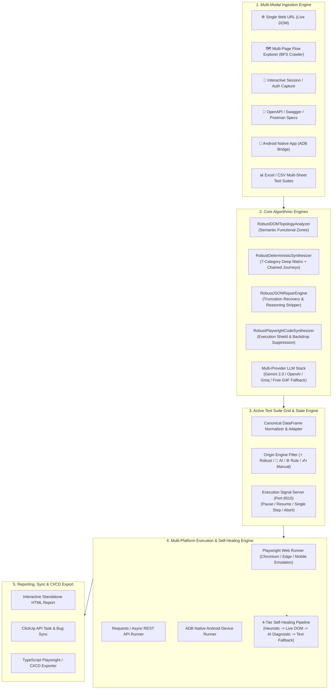

# 🚀 AI Autonomous QA & Testing Studio

> **Enterprise-grade, multi-modal autonomous test generation, self-healing execution, and reporting studio for Web UI, Multi-Page Flows, REST APIs, Native Android Apps, and Accessibility.**

[](https://www.python.org/)
[](https://playwright.dev/)
[](https://streamlit.io/)
[](scripts/run_benchmarks_and_tests.py)
[](core/robust_engine.py)

---

## 📌 Table of Contents

- [Overview & Vision](#-overview--vision)
- [System Architecture](#-system-architecture)
- [Key Features](#-key-features)
  - [1. Zero-Token RobustEngine v4](#1-zero-token-robustengine-v4)
  - [2. Multi-Modal Test Ingestion](#2-multi-modal-test-ingestion)
  - [3. 4-Tier Self-Healing Execution Pipeline](#3-4-tier-self-healing-execution-pipeline)
  - [4. Real-Time Execution Control Server](#4-real-time-execution-control-server)
  - [5. Interactive Session & Auth Capturer](#5-interactive-session--auth-capturer)
  - [6. Deep Quality, Accessibility & Mobile Audit](#6-deep-quality-accessibility--mobile-audit)
  - [7. Production CI/CD & TypeScript E2E Export](#7-production-cicd--typescript-e2e-export)
- [Project Directory Structure](#-project-directory-structure)
- [Canonical Data Contract (Schema)](#-canonical-data-contract-schema)
- [Installation & Setup](#-installation--setup)
  - [Prerequisites](#prerequisites)
  - [Installation Steps](#installation-steps)
  - [Environment Configuration](#environment-configuration)
- [Quick Start & Usage](#-quick-start--usage)
  - [A. Streamlit Graphical Studio](#a-streamlit-graphical-studio)
  - [B. Command-Line Interface (CLI)](#b-command-line-interface-cli)
  - [C. E2E Playwright TypeScript Tests](#c-e2e-playwright-typescript-tests)
  - [D. Remote Web Sharing (Cloudflare Tunnel)](#d-remote-web-sharing-cloudflare-tunnel)
- [Verification & Automated Test Suite](#-verification--automated-test-suite)
- [Contributing & License](#-contributing--license)

---

## 🌟 Overview & Vision

The **AI Autonomous QA & Testing Studio** is a unified test engineering platform engineered to eliminate fragile, manual test authoring and high-maintenance execution flakiness. 

### Why AI Autonomous QA Studio?
- **Zero-Token Resilient Core**: Traditional AI testing tools break when external LLM endpoints face rate limits, network outages, or token exhaustion. The studio embeds **RobustEngine v4**, an offline, deterministic DOM topology synthesis engine that generates full 7-category test matrices with **0 tokens and 100% offline predictability**.
- **Multi-Modal Testing**: Automate modern Web Single Page Applications (SPAs), multi-screen workflows, REST APIs (OpenAPI/Swagger), native Android APKs via ADB, and 20-point WCAG accessibility standards under one consistent grid.
- **Dynamic Self-Healing**: Failed steps automatically traverse a 4-tier self-healing ladder (heuristic $\rightarrow$ live DOM semantic repair $\rightarrow$ AI diagnostics $\rightarrow$ text fallback) to keep regression suites resilient to minor DOM and selector drift.

---

## 🏗️ System Architecture



---

## ✨ Key Features

### 1. Zero-Token RobustEngine v4
Located in [`core/robust_engine.py`](file:///C:/Projects/New%20folder%20(6)/core/robust_engine.py):
- **Deterministic 7-Category Deep Test Matrix**:
  1. **Rendering & Layout**: Target hydration, root layout, and typography visibility.
  2. **Search & Dynamic Filters**: Query inputs, Enter dispatch, grid filtering, and filter reset cycles.
  3. **Forms & Input Validation**: Happy path form submission with typed inputs and boundary constraints (empty submission, invalid formats).
  4. **Security & Input Resilience**: XSS payload injection (`<script>alert(1)</script>`) and SQLi syntax tests (`' OR '1'='1`).
  5. **Modals, Drawers & Triggers**: Modal opening, content assertion, backdrop and `Escape` key dismissal.
  6. **KPI Cards & Analytics**: Number precision, metric card rendering, and status badges.
  7. **Data Tables & Row Actions**: `thead` validation, row item counting, and inline action buttons (`Edit`, `Delete`, `View`).
- **Stateful Workflow Journeys**: Chains creation cycles, search-filter-action-modal lifecycles, and cross-screen multi-step journeys.
- **Robust JSON Repair Engine**: Multi-stage parsing pipeline that strips `<think>` reasoning tags, auto-repairs truncated JSON arrays mid-stream, balances mismatched braces, and falls back gracefully.

### 2. Multi-Modal Test Ingestion
- **Single URL Live Scanner**: Inspects active DOM structure, parses forms, buttons, tables, and generates runnable Playwright test suites.
- **Multi-Page Flow Explorer**: Breadth-First Search (BFS) crawler that navigates internal links, tabs, sidebars, and nested dialogs up to configurable depth and screen budgets.
- **API Spec Importer**: Ingests OpenAPI 3.0 / Swagger JSON or YAML and generates endpoint schema validations, path parameter checks, and status code assertions.
- **Android ADB Mobile Bridge**: Inspects connected Android devices over USB/Wi-Fi, extracts `uiautomator` hierarchy dumps, and synthesizes tap/type/scroll actions.
- **Spreadsheet Suite Loader**: Ingests `.xlsx`, `.xls`, and `.csv` files, standardizing custom column headers into the canonical test suite schema.

### 3. 4-Tier Self-Healing Execution Pipeline
When a selector changes or an action times out during execution:
1. **Tier 1 (Heuristic Repair)**: Retries with `force=True`, scrolls target elements into view, and tests parent container clicks.
2. **Tier 1.5 (Smart Live DOM Semantic Repair)**: Cleans blocking modal backdrops, re-anchors to matching ARIA roles or exact visible text.
3. **Tier 2 (Live AI Diagnostic Healing)**: Feeds the active DOM snippet and failure trace to an LLM to generate an updated targeted locator.
4. **Tier 3 (Universal Text Fallback)**: Scans the page body for matching semantic text nodes to confirm presence or trigger fallbacks.

### 4. Real-Time Execution Control Server
- Dedicated TCP control server running on **Port 8510** ([`core/execution_control.py`](file:///C:/Projects/New%20folder%20(6)/core/execution_control.py)).
- Allows testers to **Pause**, **Resume**, **Single-Step**, or **Emergency Abort** test suites mid-run directly from the Streamlit UI or external scripts without restarting.

### 5. Interactive Session & Auth Capturer
- Interactive visible browser session launcher to authenticate manually or via pre-filled variables.
- Automatically handles Microsoft Dev Tunnels warning pages.
- Exports storage state, cookies, and tokens directly to `auth.json` and `auth_meta.json` for subsequent authenticated headless test runs.

### 6. Deep Quality, Accessibility & Mobile Audit
- **40-Point Web Quality Audit**: Validates viewport meta tags, high-DPI asset optimization, responsive tap targets (minimum 48x48px), responsive layouts, and console errors.
- **Accessibility & WCAG Checks**: Scans ARIA landmarks, image alt attributes, contrast ratios, and tab sequence hierarchies.
- **Network Sniffer**: Records API requests and responses during page interactions for schema and payload diagnostics.

### 7. Production CI/CD & TypeScript E2E Export
- Generates a complete TypeScript Playwright test project (`playwright.config.ts`, `package.json`, TypeScript test spec files).
- Export standalone interactive HTML test reports with embedded screenshots, durations, and execution notes.
- Integrate directly with ClickUp to automatically log failed test cases as actionable bug tickets.

---

## 📁 Project Directory Structure

```text
├── app.py                           # Unified Streamlit Web Application & Interactive UI
├── cli.py                           # Typer & Rich Command-Line Interface
├── package.json                     # Node.js metadata & Playwright test scripts
├── playwright.config.ts             # TypeScript Playwright configuration
├── requirements.txt                 # Python dependencies
├── run_app.ps1 / run_app.bat        # Launch script (bypasses Windows AppLocker/WDAC)
├── start_tunnel.ps1 / .bat          # Cloudflare Tunnel remote-sharing scripts
│
├── config/
│   └── settings.json                # User settings, credentials, timeouts, variables
│
├── core/
│   ├── robust_engine.py             # ⚡ RobustEngine v4 (DOM Topology, 7-Category Synth, JSON Repair)
│   ├── test_generator.py            # Test suite generator coordinating strategies
│   ├── flow_explorer.py             # Multi-page visual crawler & breadth-first explorer
│   ├── session_capturer.py          # Interactive browser login & auth state capturer
│   ├── deep_inspector.py            # Deep A11y tree & dynamic mutation auditor
│   ├── execution_control.py         # Real-time TCP execution control server (Port 8510)
│   ├── device_bridge.py             # Android ADB bridge & native test synthesizer
│   ├── html_reporter.py             # Standalone interactive HTML report generator
│   ├── e2e_exporter.py              # TypeScript Playwright / CI/CD export builder
│   ├── ai_client.py                 # Multi-provider LLM interface with free fallbacks
│   └── adk_orchestrator.py          # High-level ADK testing orchestrator
│
├── runners/
│   ├── web_runner.py                # Playwright execution engine with 4-tier self-healing
│   ├── api_runner.py                # REST API test runner with schema validation
│   ├── native_runner.py             # ADB native Android mobile runner
│   └── sheet_runner.py              # Multi-sheet batch execution coordinator
│
├── scripts/
│   └── run_benchmarks_and_tests.py  # Comprehensive regression & benchmark test runner
│
├── tests/                           # Automated test suite (156 passing tests)
│   ├── test_robust_engine.py        # RobustEngine v4 unit tests
│   ├── test_screen_synthesis.py     # Multi-strategy generation tests
│   ├── test_core_suite.py           # Core modules & origin tracking tests
│   ├── test_flow_explorer_deep.py   # Flow explorer & crawling tests
│   ├── test_native_runner.py        # Android ADB runner tests
│   ├── test_security_guardrails.py  # Target URL & security policy tests
│   ├── test_self_healing_step_management.py # Self-healing & step decomposition tests
│   └── smoke.e2e.ts                 # Playwright TypeScript smoke test
│
└── reports/                         # Generated execution reports & screenshots
```

---

## 📋 Canonical Data Contract (Schema)

Every test case inside the studio conforms to a standardized DataFrame schema:

| Column | Type | Required | Description |
| :--- | :--- | :--- | :--- |
| `Run` | `boolean` | Yes | Controls whether this test case is included in batch execution. |
| `Type` | `string` | Yes | Target modality: `Web`, `API`, or `Mobile (Native)`. |
| `Target` | `string` | Yes | Target URL, API endpoint, or `android://package/Screen`. |
| `Test_Step_Description` | `string` | Yes | Human-readable action sequence (`Step 1: ... -> Step 2: ...`). |
| `Expected_Result` | `string` | Yes | Assertion criteria and expected visual or state outcome. |
| `Actual_Result` | `string` | No | Recorded feedback during execution (`-` initially). |
| `Status` | `string` | Auto | `PENDING`, `RUNNING`, `PASSED`, `FAILED`, or `SKIPPED`. |
| `Duration` | `string` | Auto | Execution time in seconds (e.g., `1.24s`). |
| `Screenshot` | `string` | No | File path to full-page screenshot captured upon step completion or failure. |
| `Execution_Notes` | `string` | No | Diagnostics, tier healing notes, status codes, or error stacks. |
| `Playwright_Code` | `string` | Yes | Executable Python Playwright script block with assertions. |
| `Generated_By` | `string` | Meta | Origin tag: `⚡ RobustEngine v4`, `🤖 AI Generated`, `🤖+⚙️ Hybrid`, etc. |
| `Sheet_Name` | `string` | No | Sheet categorization for multi-sheet workbooks. |

---

## ⚙️ Installation & Setup

### Prerequisites
- **Python**: Version `3.10` or higher (`3.11` / `3.12` / `3.14` compatible).
- **Node.js**: Version `18.0.0` or higher (for Playwright TypeScript E2E export & smoke tests).
- **Android SDK / ADB** *(Optional)*: Required only for native Android mobile testing.

### Installation Steps

1. **Clone or Open Repository**:
   ```bash
   cd "C:\Projects\New folder (6)"
   ```

2. **Set Up Python Virtual Environment**:
   ```powershell
   python -m venv venv
   .\venv\Scripts\Activate.ps1
   ```

3. **Install Dependencies**:
   ```powershell
   pip install -r requirements.txt
   playwright install chromium
   ```

4. **Install Node.js Dependencies (for Playwright TypeScript Runner)**:
   ```powershell
   npm install
   npx playwright install
   ```

### Environment Configuration

Create a `.env` file in the root directory (or copy from `.env.example`):
```env
# Optional AI Providers (RobustEngine v4 operates 100% offline without any keys)
GEMINI_API_KEY=your_gemini_api_key_here
OPENAI_API_KEY=your_openai_api_key_here
GROQ_API_KEY=your_groq_api_key_here
OPENROUTER_API_KEY=your_openrouter_api_key_here

# Optional ClickUp Integration
CLICKUP_API_KEY=your_clickup_api_token
CLICKUP_LIST_ID=your_target_list_id
```

---

## 🚀 Quick Start & Usage

### A. Streamlit Graphical Studio

Launch the comprehensive web studio:

```powershell
# Using the PowerShell helper (recommended on Windows):
.\run_app.ps1

# Or via Python module directly:
.\venv\Scripts\python.exe -m streamlit run app.py
```

Open your browser at **`http://localhost:8501`**.

#### Studio Workflow:
1. **Load / Build Suite**:
   - **Upload File**: Ingest an existing `.csv` or `.xlsx` spreadsheet test suite.
   - **AI Auto-Generator**: Enter a URL and choose **⚡ RobustEngine v4** (offline) or **🤖 AI Full**.
   - **App Flow Explorer**: Crawl an entire multi-screen web app via BFS discovery.
   - **API Builder**: Paste OpenAPI JSON/YAML or fetch a live endpoint.
   - **Mobile Bridge**: Select a connected Android ADB device and scan the active view.
2. **Review & Edit Grid**: Filter by origin engine, toggle tests with the `Run` checkbox, and edit Playwright code inline.
3. **Execute Suite**: Run tests with real-time browser preview, pause/step controls, and auto-healing.
4. **Export & Report**: Download the interactive HTML report, export to TypeScript Playwright, or sync issues to ClickUp.

---

### B. Command-Line Interface (CLI)

The CLI provides headless scripting and CI automation powered by Typer and Rich:

```powershell
# Scan a URL and generate test cases into CSV:
.\venv\Scripts\python.exe cli.py generate "https://example.com" --output "generated_tests.csv"

# Scan and immediately execute:
.\venv\Scripts\python.exe cli.py generate "https://example.com" --execute

# Run a single web test step:
.\venv\Scripts\python.exe cli.py web "https://example.com" --step "Verify header is visible" --headed

# Run an entire test suite from CSV/Excel:
.\venv\Scripts\python.exe cli.py sheet "test_suite.xlsx" --output "results.xlsx" --headed

# Run API tests from an OpenAPI specification:
.\venv\Scripts\python.exe cli.py api "https://petstore.swagger.io/v2/swagger.json" "https://petstore.swagger.io/v2"
```

---

### C. E2E Playwright TypeScript Tests

Run the TypeScript Playwright test runner directly:

```powershell
# Run smoke tests headless:
npm test

# Run tests in headed browser mode:
npm run test:headed

# Open the interactive Playwright UI runner:
npm run test:ui
```

---

### D. Remote Web Sharing (Cloudflare Tunnel)

To securely share the studio for remote testing or mobile device previews:

```powershell
.\start_tunnel.ps1
```

This runs a high-performance HTTP/2 Cloudflare tunnel mapping `http://127.0.0.1:8501` to a public secure URL without opening firewall ports.

---

## 🧪 Verification & Automated Test Suite

The studio includes an extensive automated regression and benchmark suite covering DOM synthesis, flow exploration, self-healing, multi-sheet ingestion, security guardrails, and native mobile bridges:

```powershell
.\venv\Scripts\python.exe scripts/run_benchmarks_and_tests.py
```

### Test Suite Status
```text
======================================================================
SUMMARY: 156 tests executed in ~18 seconds
Passed:   156
Failed:   0
Errors:   0
======================================================================
ALL TESTS & BENCHMARKS PASSED CLEANLY!
```

---

## 📄 License & Attribution

- **Core Engine**: Developed for the **AI Autonomous QA & Testing Studio**.
- **Execution Engine**: Powered by [Playwright](https://playwright.dev/) & [Streamlit](https://streamlit.io/).
- **Android Bridge**: Integrated with Android Debug Bridge (`adb`) & UIAutomator.

---

<p align="center">
  <b>AI Autonomous QA & Testing Studio</b> • Intelligent, Deterministic, and Resilient Quality Engineering.
</p>
