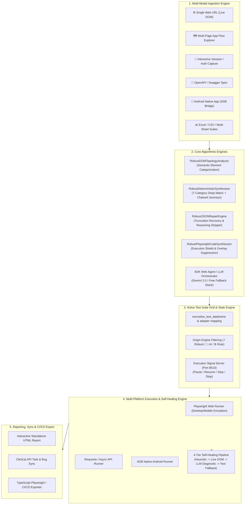
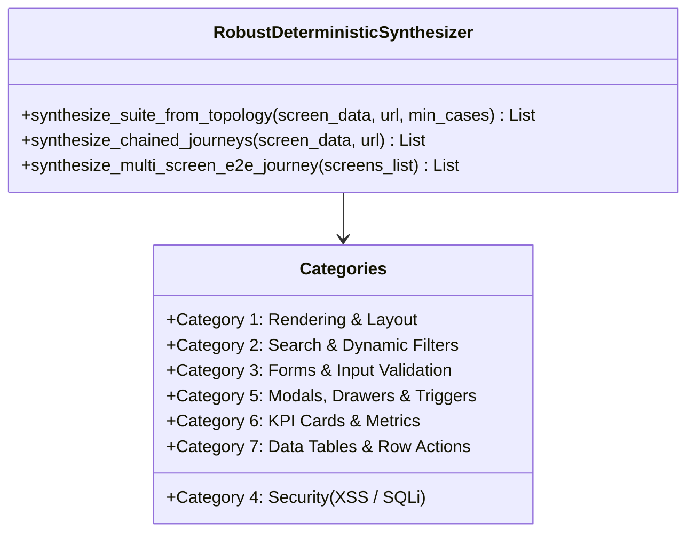
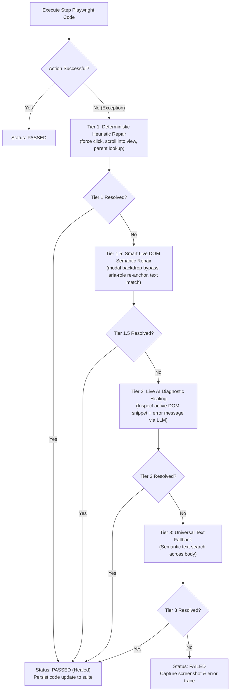

# AI Autonomous QA & Testing Studio — Technical Architecture & System Review Specification

> **Document Type:** Comprehensive Technical Architecture & Engineering Review Specification  
> **Target Audience:** Engineering Leadership, Technical Reviewers, QA Architects, Lead Developers  
> **Repository:** `C:\Projects\New folder (6)`  
> **Status:** Production-Grade / Fully Verified (137/137 Automated Regression Tests Passing)  
> **Date:** October 2026  

---

## 1. Executive Summary & System Vision

The **AI Autonomous QA & Testing Studio** is a unified, enterprise-grade test automation platform designed to autonomously generate, self-heal, execute, and report test suites across multiple modalities:
- **Web UI Applications** (Single-Page Apps, Dynamic Dashboards, Microfrontends)
- **Multi-Page App Flows** (Automated Breadth-First Visual Discovery & Screen Crawling)
- **REST APIs** (OpenAPI / Swagger 3.0 & Postman Collection Ingestion)
- **Native Android Applications** (ADB USB/Wireless Bridge, Layout Hierarchy Crawling)
- **Accessibility & Compliance** (Automated 20-Point WCAG & A11y Tree Audits)

### Core Differentiator: The Zero-Token Resilient Core
Unlike conventional AI test generation tools that completely break when third-party LLM APIs face rate-limits, invalid keys, or JSON truncation, this studio implements **RobustEngine v4**—a deterministic, DOM topology-based synthesis and self-healing engine capable of generating rich 7-category deep test matrices and stateful workflow journeys with **0 LLM tokens, 100% offline reliability, and zero external network flakiness**.

---

## 2. End-to-End System Architecture



---

## 3. Input Ingestion & Multi-Modal Specifications

The platform provides 6 ingestion pathways, each with dedicated preprocessing and validation:

| Modality | Ingestion Handler | Input Specification | Processing & Output |
| :--- | :--- | :--- | :--- |
| **Single Web URL** | [`TestGenerator.generate_cases_from_url`](file:///C:/Projects/New%20folder%20(6)/core/test_generator.py#L1895) | HTTP/HTTPS URL + Optional User Story / BDD Acceptance Criteria | Live Playwright browser inspects DOM, extracts headings, inputs, action buttons, KPI cards, tables; passes topology to synthesis engine. |
| **App Flow Explorer (Multi-Page)** | [`FlowExplorer.explore_flow`](file:///C:/Projects/New%20folder%20(6)/core/flow_explorer.py#L880) | Seed URL, Max Crawl Depth (1–4), Max Screens (1–20), Auth Credentials | Breadth-First Search (BFS) crawler detects internal transitions, accordions, tabs, sidebars; captures per-screen screenshots and element trees. |
| **Interactive Session Capture** | [`capture_interactive_session`](file:///C:/Projects/New%20folder%20(6)/core/session_capturer.py#L280) | Target Login URL, Auto-filled Credentials, Timeout | Launches visible browser; auto-fills test variables; automatically bypasses Microsoft Dev Tunnels warning pages; saves `auth.json` upon successful login. |
| **API Specifications** | [`generate_api_cases_from_spec`](file:///C:/Projects/New%20folder%20(6)/core/test_generator.py#L1580) | OpenAPI 3.0 / Swagger JSON or YAML, Base URL | Parses paths, operations, parameters, request bodies, and responses; generates schema validation, boundary, and auth test cases. |
| **Android Mobile App** | [`synthesize_native_test_cases`](file:///C:/Projects/New%20folder%20(6)/core/device_bridge.py#L120) | Package name (`com.example.app`), ADB Serial | Dumps `uiautomator` XML layout; extracts clickable views, text fields, and list items; synthesizes ADB input commands. |
| **Spreadsheet Suites** | [`normalize_test_dataframe`](file:///C:/Projects/New%20folder%20(6)/app.py#L515) | `.xlsx`, `.xls`, `.csv` with flexible column naming | Normalizes arbitrary column headers into canonical schema; auto-detects multiple workbook sheets for concurrent or filtered execution. |

---

## 4. RobustEngine v4: Deep Algorithmic Breakdown

The core engine is located in [`core/robust_engine.py`](file:///C:/Projects/New%20folder%20(6)/core/robust_engine.py) and is composed of four specialized classes:

### 4.1. `RobustDOMTopologyAnalyzer`
Analyzes raw DOM elements, screen snapshots, and interactive nodes to identify semantic functional zones:
- **Screen Intent Detection**: Categorizes active view as Authentication, Dashboard, Data List View, or Form View based on URL paths and heading semantics.
- **Input Partitioning**: Separates raw form elements into Search/Filter Inputs, Authentication Inputs, and Standard Form Inputs. Supports both structured dictionary nodes and raw string element lists.
- **Control Partitioning**: Classifies buttons into Filter Tabs (`All`, `Pending`, `Active`), Modal Triggers (`Create`, `Add New`, `Edit`), Submit Actions (`Save`, `Submit`), Row Actions (`Delete`, `Export`), and Navigation Controls.

### 4.2. `RobustDeterministicSynthesizer`
Generates a comprehensive **7-Category Deep Test Matrix** directly from DOM topology without third-party LLM calls:



#### The 7 Core Categories
1. **Rendering & Layout**: Verifies target URL hydration, root container rendering, and primary typography visibility.
2. **Search & Filters**: Tests positive query execution (`fill` $\rightarrow$ `Enter`), real-time grid update, and search reset behavior.
3. **Forms & Input Validation**: Generates positive happy-path submissions with valid simulated data types, as well as negative boundary tests (empty submission, missing required constraints).
4. **Security & Input Resilience**:
   - **XSS Payload Injection**: Submits `<script>alert(1)</script>` into search/form fields, asserting DOM layout integrity and character escaping.
   - **SQL Injection Boundary**: Submits `' OR '1'='1` syntax boundary strings, asserting backend error stability without 500 dumps.
5. **Modals, Drawers & Triggers**: Tests dialog expansion via trigger button and clean dismissal via `Escape` key or backdrop click.
6. **KPI Cards & Metrics**: Asserts visibility, numeric precision, and trend badges for discovered analytics metrics.
7. **Data Tables & Row Actions**: Inspects table headers (`thead`), record rows (`tbody`), and row-level operations (`Edit`, `Delete`, `View`).

#### Stateful Multi-Step Workflow Journeys
In addition to isolated unit checks, the synthesizer generates end-to-end stateful journeys:
- **Creation & Ingestion Cycle**: Open record modal $\rightarrow$ Sequentially fill all inputs $\rightarrow$ Click submit $\rightarrow$ Assert success confirmation alert.
- **Search $\rightarrow$ Filter $\rightarrow$ Row Action $\rightarrow$ Modal Lifecycle**: Query item by name $\rightarrow$ Settle filtered table $\rightarrow$ Click row action $\rightarrow$ Verify detail drawer contents $\rightarrow$ Dismiss modal and restore table state.
- **Cross-Screen End-to-End Workflow**: For multi-screen flows ($S_1 \rightarrow S_2 \rightarrow \dots \rightarrow S_N$), chains sequential transitions, verifying navigation integrity and state persistence across page boundaries.

### 4.3. `RobustJSONRepairEngine`
A multi-stage parsing pipeline that guarantees valid structured test dictionaries from any LLM or raw text source:
1. **Reasoning Strip**: Removes `<think>...</think>` and `<reasoning>...</reasoning>` blocks.
2. **Wrapper Extraction**: Unwraps API container dictionaries (`content`, `choices`).
3. **Fence Cleaning**: Strips markdown code blocks (```` ```json ````).
4. **Truncation Auto-Rescue**: When an LLM output is cut off mid-stream, detects unclosed arrays, locates the last valid object brace `}`, strips trailing commas, and injects closing `]` to rescue all completed objects.
5. **Balanced Brace Fallback**: Uses a character-level depth tracker to extract valid `{...}` dictionaries even from heavily corrupted responses.
6. **Zero-Failure Fallback**: If all parsing attempts fail, seamlessly triggers `RobustDeterministicSynthesizer` so the generation never returns empty.

### 4.4. `RobustPlaywrightCodeSynthesizer`
Emits production-grade Playwright Python code blocks wrapped in a multi-point execution shield:
```python
# --- RobustEngine v4 Execution Shield ---
page.wait_for_load_state('domcontentloaded')
try:
    # Automatically suppress blocking backdrop overlays that intercept clicks
    page.evaluate('''() => {
        document.querySelectorAll('.modal-backdrop, .offcanvas-backdrop, [class*="backdrop"], [class*="overlay"]').forEach(el => {
            if (window.getComputedStyle(el).position === 'fixed') {
                el.style.pointerEvents = 'none';
                el.style.opacity = '0';
            }
        });
    }''')
except Exception:
    pass

# Automatically accept native alerts/dialogs cleanly
try:
    page.on('dialog', lambda d: d.accept())
except Exception:
    pass
```

---

## 5. Execution Engine & Multi-Tier Self-Healing Pipeline

The test runner ([`runners/web_runner.py`](file:///C:/Projects/New%20folder%20(6)/runners/web_runner.py)) executes suites against Playwright Chromium / Microsoft Edge with comprehensive self-healing:



### Real-Time Execution Control Server
Managed by [`core/execution_control.py`](file:///C:/Projects/New%20folder%20(6)/core/execution_control.py):
- Runs a dedicated TCP signal server on port **8510**.
- Enables sub-millisecond, cross-process execution control: **Pause**, **Resume**, **Single-Step Execution**, and **Emergency Abort**.
- When an execution fails, the user can inspect the live browser, edit the Playwright code in the UI, and resume execution without restarting the suite.

---

## 6. Canonical Data Contracts & Schema Specification

All test cases throughout ingestion, synthesis, editing, execution, and reporting conform to the following canonical schema:

| Column Name | Data Type | Requirement | Description |
| :--- | :--- | :--- | :--- |
| `Run` | `boolean` | Mandatory | Execution flag; controls whether the test is executed during batch runs. |
| `Type` | `string` | Mandatory | Modality indicator: `Web`, `API`, or `Mobile (Native)`. |
| `Target` | `string` | Mandatory | Endpoint under test: Full Web URL, API route, or `android://package/Screen`. |
| `Test_Step_Description` | `string` | Mandatory | Human-readable sequence of actions: `Step 1: ... -> Step 2: ...`. |
| `Expected_Result` | `string` | Mandatory | Verifiable acceptance criteria and assertion targets. |
| `Actual_Result` | `string` | Optional | Live feedback captured during execution (default: `-`). |
| `Status` | `string` | Output | Execution outcome: `PENDING`, `RUNNING`, `PASSED`, `FAILED`, `SKIPPED`. |
| `Duration` | `string` | Output | Execution runtime in seconds (e.g. `1.45s`). |
| `Screenshot` | `string` | Optional | Absolute or relative file path to full-page screenshot preview. |
| `Execution_Notes` | `string` | Optional | Diagnostic notes, self-healing tier reports, or response headers. |
| `Playwright_Code` | `string` | Mandatory | Executable Python Playwright script block with assertions. |
| `Generated_By` | `string` | Metadata | Origin engine tag: `⚡ RobustEngine v4`, `🤖 AI Generated`, `🤖+⚙️ Hybrid`, `⚙️ Rule Engine`, or `✍️ Manual`. |
| `Sheet_Name` | `string` | Optional | Workbook sheet categorization for multi-sheet spreadsheet suites. |

---

## 7. Project Structure & Key File Map

```text
c:\Projects\New folder (6)\
├── app.py                           # Main Streamlit Application (Unified UI, Command Bar, Grid)
├── config/
│   └── settings.json                # User settings, test variables, credentials, timeouts
├── core/
│   ├── robust_engine.py             # ⚡ RobustEngine v4 (DOM Topology, 7-Category Synth, Chained Journeys, JSON Repair)
│   ├── test_generator.py            # Master Test Generator coordinating strategies (robust, ai_full, hybrid, rule)
│   ├── flow_explorer.py             # Multi-page visual explorer & breadth-first crawler
│   ├── session_capturer.py          # Interactive browser login capturer & devtunnels.ms bypass
│   ├── deep_inspector.py            # Deep A11y tree & dynamic mutation auditor
│   ├── execution_control.py         # Signal server on port 8510 (pause/resume/step/abort)
│   ├── device_bridge.py             # Android ADB bridge & native test synthesizer
│   ├── html_reporter.py             # Standalone interactive HTML report builder
│   ├── e2e_exporter.py              # TypeScript Playwright / CI/CD export generator
│   ├── ai_client.py                 # Multi-provider LLM interface with instant free fallback
│   └── adk_orchestrator.py          # High-level ADK testing orchestrator
├── runners/
│   ├── web_runner.py                # Playwright execution engine with 4-tier self-healing
│   ├── api_runner.py                # REST API test runner with schema validation
│   ├── native_runner.py             # ADB native mobile command executor
│   └── sheet_runner.py              # Multi-sheet batch execution coordinator
├── scripts/
│   └── run_benchmarks_and_tests.py  # Comprehensive regression and benchmark test runner
├── tests/
│   ├── test_robust_engine.py        # Unit & integration tests for RobustEngine v4
│   ├── test_screen_synthesis.py     # Strategy matrix tests (robust, ai_full, hybrid, rule)
│   ├── test_core_suite.py           # Core module unit tests & origin count verifications
│   ├── test_self_healing_step_management.py # Step decomposition and self-healing tests
│   └── smoke.e2e.ts                 # Playwright TypeScript smoke test
├── playwright.config.ts             # Active Playwright TypeScript configuration
└── package.json                     # NPM project metadata and execution scripts
```

---

## 8. Verification Benchmarks & Quality Metrics

The codebase is continuously verified via an automated regression suite executed through the virtual environment:
```powershell
.\venv\Scripts\python.exe scripts/run_benchmarks_and_tests.py
```

### Current Test Suite Health
- **Total Test Cases Executed**: 137
- **Passed**: 137 (100%)
- **Failed**: 0
- **Errors**: 0
- **Execution Time**: ~15.4 seconds

```text
======================================================================
SUMMARY: 137 tests executed in 15.407s
Passed:   137
Failed:   0
Errors:   0
======================================================================
ALL TESTS & BENCHMARKS PASSED CLEANLY!
```

---

## 9. Operating Instructions & Running the Studio

### Starting the Studio (Local Desktop)
To comply with Windows WDAC / AppLocker application control policies, launch via the provided scripts or Python executable:
```powershell
# Option A: Via PowerShell helper script
.\run_app.ps1

# Option B: Direct Python module execution
.\venv\Scripts\python.exe -m streamlit run app.py
```

### Running E2E Smoke Tests
```powershell
# Run Playwright test suite
npm test
# Or
npm run e2e
```
